# Technical Specifications Document

## 1. Title Page

- **Project Name**: Event Booking System
- **Version**: 0.3
- **Date**: October 29, 2026
- **Author(s)**:
    - Michael Angelo A. Ochengco
    - Jan Laurence H. Olarte
    - Eric John A. Peña
    - Angelica Janine M. Reyes
    - Leigh Andrea D. Silang

## 2. Table of Contents

1. [Introduction](#3-introduction)
2. [Overall Description](#4-overall-description)
3. [Visual Mockup Reference](#5-visual-mockup-reference)
4. [Features](#6-features)
5. [Functional Requirements](#7-functional-requirements)
6. [Non-Functional Requirements](#8-non-functional-requirements)
7. [Data Requirements](#9-data-requirements)
8. [External Interface Requirements](#10-external-interface-requirements)
9. [Glossary](#11-glossary)
10. [Appendices](#12-appendices)

## 3. Introduction

- **Purpose**: To develop an Event Booking System that enables customers to discover concerts and special events, browse event information, select tickets, complete bookings through simulated payment, and receive electronic tickets. The system also allows customers to manage their profile information and administrators to manage events, tickets, and bookings.

- **Scope**: The system includes a home page featuring events and a call-to-action (CTA), an event catalog, event information, event date and time selection, ticket type selection, seat selection where applicable, a simulated payment process, electronic ticket generation after successful booking, customer profile management, VIP package viewing, and an admin dashboard with basic create, read, update, and delete (CRUD) operations for events, tickets, and bookings. Real payment processing, advanced venue maps, analytics, automated email/SMS notifications, and other optional functionality are excluded from the MVP.

- **Definitions, Acronyms, and Abbreviations**:
    - **GA**: General Admission
    - **VIP**: Very Important Person
    - **CRUD**: Create, Read, Update, Delete
    - **API**: Application Programming Interface

- **References**:
    - [Project Brief](../../../references/project-brief.pdf)
    - [Client Inquiries](../../../references/client-inquiries.md)
    - [Project Requirements Baseline](../../../references/requirements-baseline.md)
    - [Sample TSD](../../../references/sample-tsd.md)

## 4. Overall Description

- **Product Perspective**: The Event Booking System is a standalone web-based platform designed to simplify the discovery and booking of concert and special event tickets. It provides customer-facing features for event browsing and ticket booking, along with a dedicated administrative interface for managing events, tickets, and bookings.

- **Product Functions**:
    - **Home Page** – Displays featured events and a hero section with a clear call-to-action (CTA).
    - **Event Catalog and Details** – Allows customers to browse events and review relevant event information, including available dates, venues, ticket options, and VIP packages.
    - **Ticket Selection and Seat Reservation** – Allows customers to select an event date and time, choose a ticket type such as General Admission, Premium, or VIP, and select an available seat where assigned seating applies.
    - **Booking and Checkout** – Guides customers through the booking process and provides a simulated payment step.
    - **Electronic Ticket Generation** – Generates an electronic ticket after a successful booking and payment process.
    - **Customer Profile Management** – Allows customers to view and manage their profile information.
    - **Admin Dashboard** – Provides administrators

## 5. Visual Mockup Reference

### Desktop Mockups

1. **Home Page**

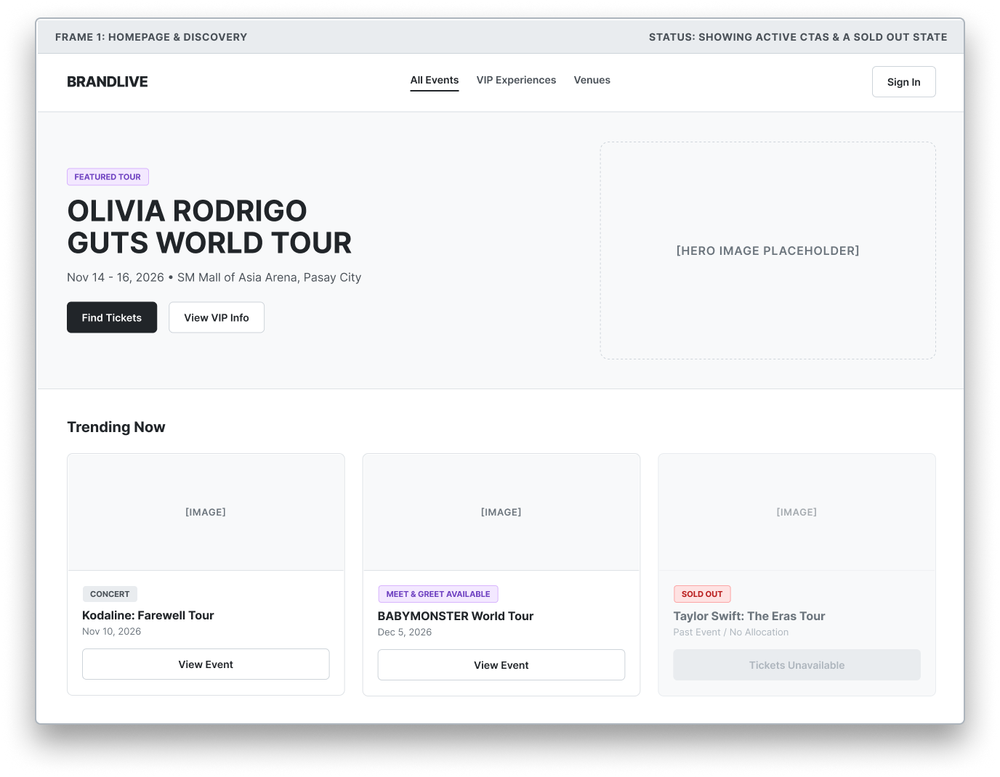

2. **Event Details**

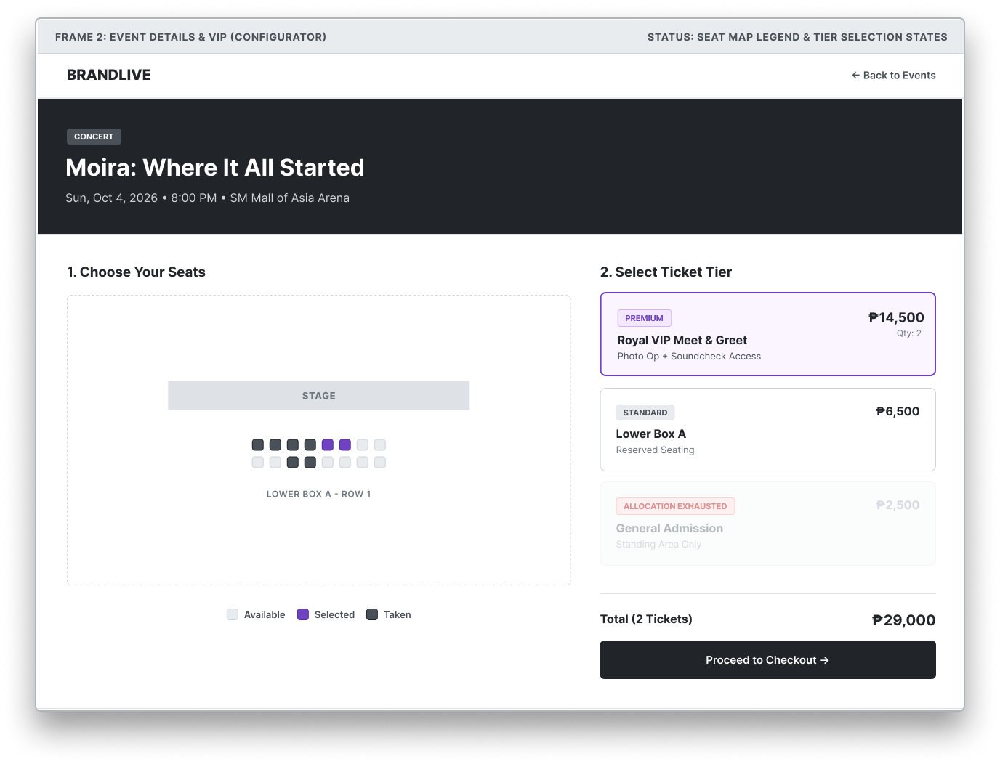

3. **Checkout**

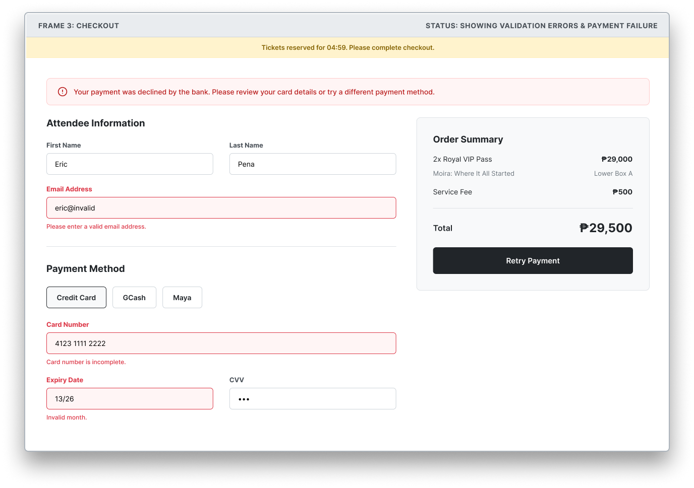

4. **Booking Confirmation**

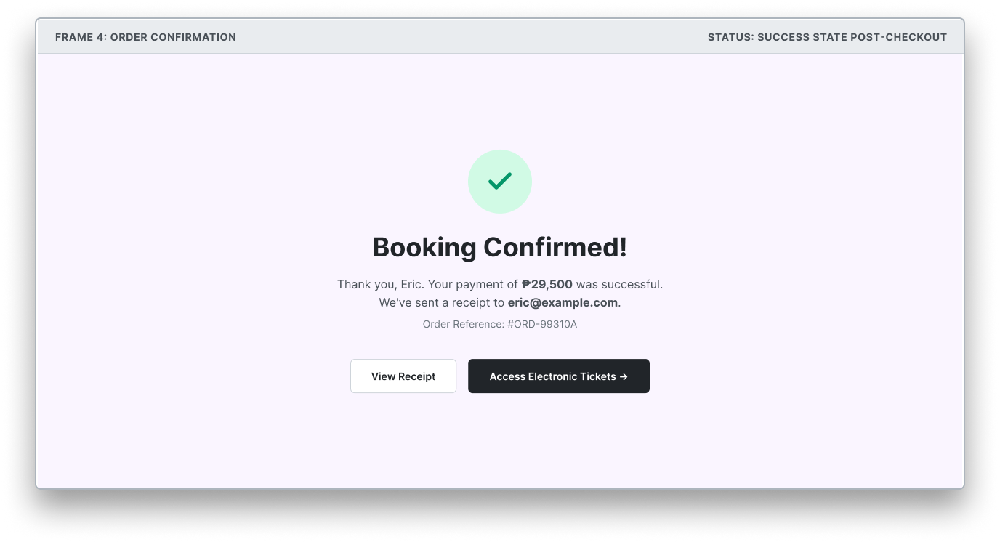

5. **User Profile**

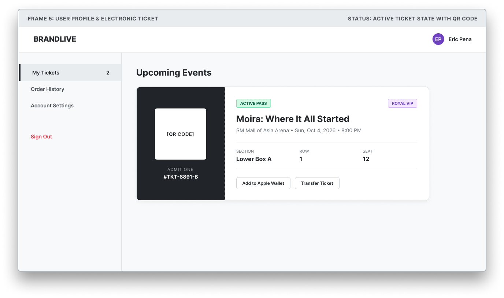

6. **Admin Dashboard**

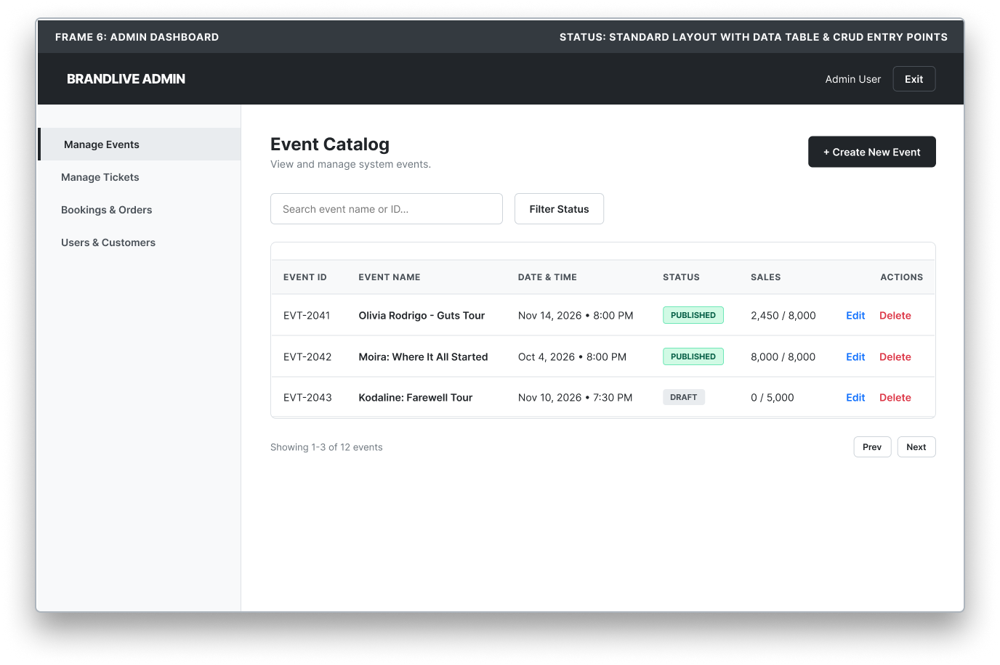

7. **Admin Empty Dashboard**

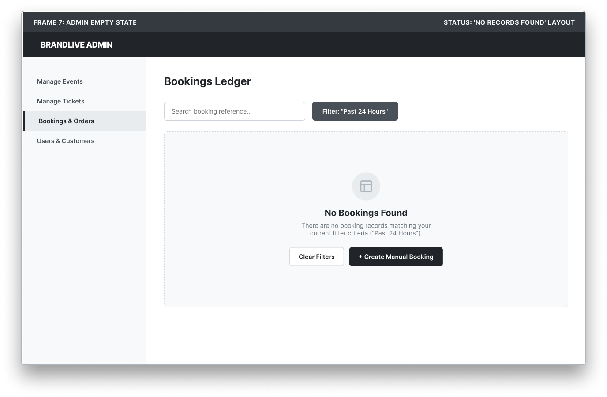

### Mobile Mockups

1. **Home Page**

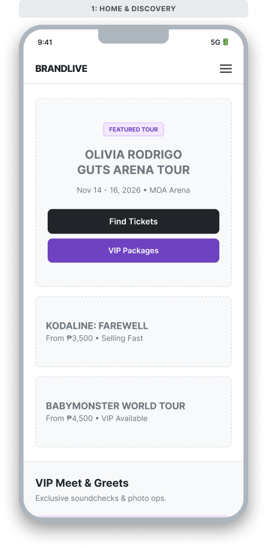

2. **Catalog**

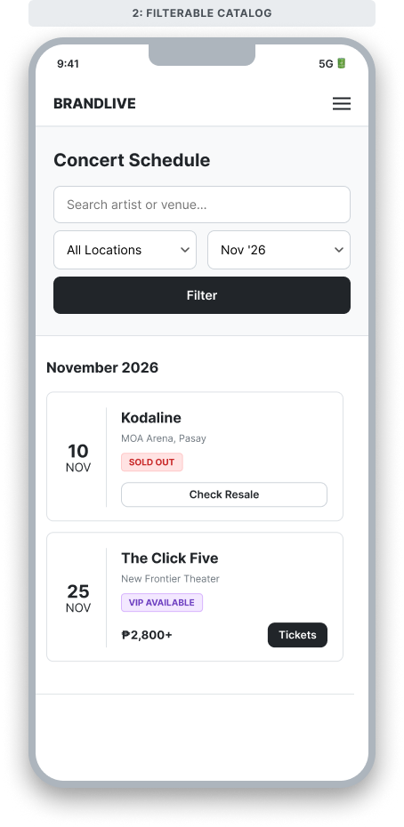

3. **Event Details**

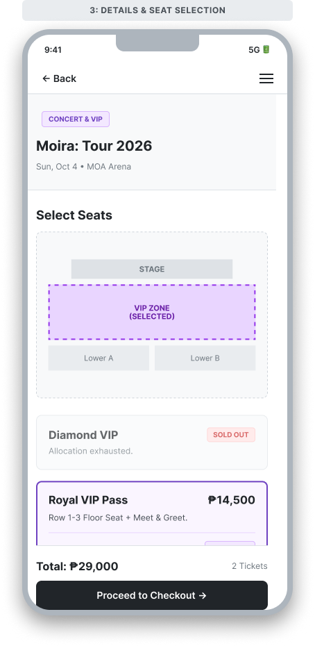

4. **Checkout**

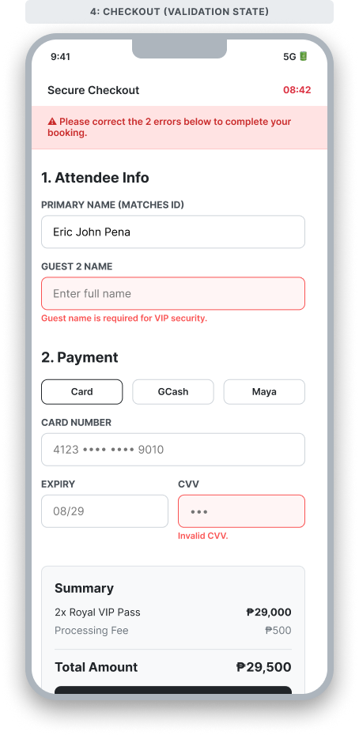

5. **Booking Confirmation**

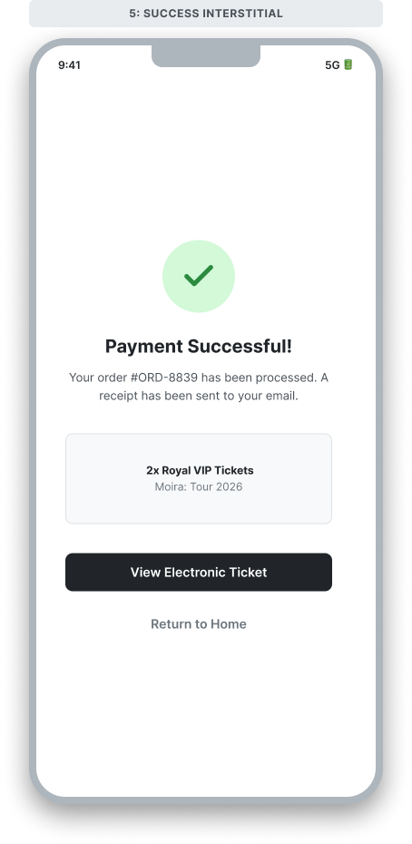

6. **Ticket Details**

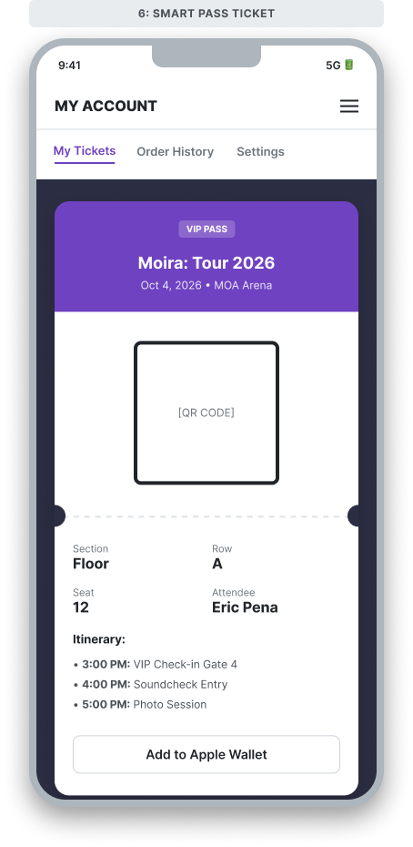

7. **Admin Dashboard**

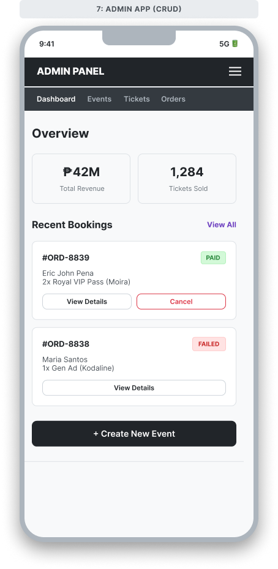

### Typography Guide

- [Link to Typography Guide](../../Typgraphy%20Guide/Typography-Guide.md)

## 6. Features

- **Featured Events & Home CTA**: Display featured events and a clear call-to-action in the hero section.
- **Event Catalog & Details**: Allow customers to browse concerts and special events and review event descriptions, dates, venues, pricing, and available VIP packages.
- **Booking & Ticket Selection**: Allow customers to select an event date and time, ticket type (General Admission, Premium, or VIP), and assigned seat where applicable.
- **Payment & Electronic Ticket Generation**: Include a simulated payment step and automatically generate an electronic ticket upon successful booking.
- **Customer Profile Management**: Allow customers to view and manage their profile information.
- **Admin Dashboard & Management**: Provide a dedicated admin dashboard with basic CRUD operations for managing events, tickets, and bookings.

## 7. Functional Requirements

### Use Cases

- **Use Case 1**: Event Ticket Booking and Electronic Ticket Generation
    - **Title**: Book an event ticket
    - **Description**: The customer browses available events, selects an event date and time, chooses a ticket type and an available seat where applicable, completes the booking process through simulated payment, and receives an electronic ticket.
    - **Actors**: Customer
    - **Preconditions**: The customer can access the event catalog or event details, and tickets are available for the selected event session.
    - **Postconditions**: Upon successful payment, the booking is recorded as confirmed and an electronic ticket is generated. The selected seat is reserved where assigned seating applies.
    - **Main Flow**:
        1. The customer visits the home page or event catalog.
        2. The customer selects an event and views its details.
        3. The customer chooses an event date and time.
        4. The customer selects a ticket type, such as General Admission, Premium, or VIP.
        5. The customer selects an available seat if assigned seating applies.
        6. The customer reviews the booking details and proceeds to checkout.
        7. The customer completes the simulated payment.
        8. The system records the successful booking and generates an electronic ticket.
        9. The customer views the booking confirmation and accesses the electronic ticket.
    - **Alternate Flows**:
        - **Unavailable Ticket or Seat**: If the selected ticket or seat is no longer available, the system informs the customer and allows them to select another available option.
        - **Payment Failure**: If the simulated payment fails, the system informs the customer that the booking has not been confirmed.

### System Features

- **Feature 1**: Home Page and Event Discovery
    - **Description**: Display featured events, a hero-section CTA, and an event catalog for browsing available events.
    - **Priority**: High
    - **Inputs**: Customer navigation and event selection.
    - **Processing**: Retrieve and display event listings with relevant information, such as event title, image, date, venue, and starting ticket price where available.
    - **Outputs**: Featured event displays, event catalog listings, and event detail views.
    - **Error Handling**: Display an appropriate message when no events are available.

- **Feature 2**: Booking and Payment Processing
    - **Description**: Allow customers to select an event date and time, ticket type, and seat where applicable, review booking details, and complete simulated payment.
    - **Priority**: High
    - **Inputs**: Selected event session, ticket type, seat selection where applicable, and payment action.
    - **Processing**: Validate ticket availability, calculate the booking total, and process the simulated payment outcome.
    - **Outputs**: Booking confirmation or payment failure notification.
    - **Error Handling**: Display appropriate messages for unavailable tickets, invalid selections, and unsuccessful simulated payments.

- **Feature 3**: Electronic Ticket Generation
    - **Description**: Generate an electronic ticket after a successful booking and simulated payment.
    - **Priority**: High
    - **Inputs**: Confirmed booking and associated event and ticket information.
    - **Processing**: Create an electronic ticket containing the relevant booking and event details.
    - **Outputs**: An electronic ticket accessible through the booking confirmation.
    - **Error Handling**: Inform the customer if ticket generation fails and prevent the system from presenting an incomplete booking as fully completed.

- **Feature 4**: Customer Profile Management
    - **Description**: Allow customers to view and manage their profile information.
    - **Priority**: High
    - **Inputs**: Customer profile information and update requests.
    - **Processing**: Validate and save permitted profile changes.
    - **Outputs**: Updated customer profile information.
    - **Error Handling**: Display validation messages or notify the customer if a profile update fails.

- **Feature 5**: VIP Package Viewing
    - **Description**: Allow customers to view available VIP packages and their relevant information.
    - **Priority**: High
    - **Inputs**: Customer request to view VIP packages.
    - **Processing**: Retrieve and display available VIP package information.
    - **Outputs**: A view of available VIP packages and their details.
    - **Error Handling**: Display an appropriate message when no VIP packages are available.

- **Feature 6**: Admin Dashboard and Management
    - **Description**: Provide a dedicated admin dashboard for managing events, tickets, and bookings through basic CRUD operations.
    - **Priority**: High
    - **Inputs**: Authorized administrator actions and event, ticket, or booking data.
    - **Processing**: Validate administrator access and process create, read, update, and delete operations for the supported records.
    - **Outputs**: Updated records and confirmation messages.
    - **Error Handling**: Display appropriate error messages for invalid data, failed operations, or unauthorized access.

## 8. Non-Functional Requirements

- **Performance**:
    - The system should load and display event listings and relevant event information efficiently to support a smooth browsing and booking experience.
    - The system should process booking requests and simulated payment outcomes without unnecessary delays.

- **Security**:
    - Administrative functions must be accessible only to authorized administrators.
    - Customer profile information and booking records must be protected against unauthorized access or modification.
    - The simulated payment process must not require or expose real financial credentials.

- **Usability**:
    - The interface must provide clear navigation between event discovery, event details, ticket selection, checkout, and ticket confirmation.
    - The system must provide clear visual feedback for selected dates, ticket types, seat availability where applicable, and booking outcomes.
    - The interface must support responsive layouts for desktop and mobile devices.

- **Reliability and Data Integrity**:
    - The system must record successful bookings and generate electronic tickets only after the booking process has succeeded.
    - The system must maintain consistent booking and ticket records.
    - Ticket availability must be checked before confirming a booking to reduce the risk of conflicting reservations.

- **Supportability**:
    - The codebase must be organized into maintainable components and modules.
    - Data structures and application logic must support the required event management, ticket management, booking, customer profile, and electronic ticket functionality.

## 9. Data Requirements

- **Data Models**:
    - **User/Customer**: { id, email, password_hash, full_name, profile_info, role }
        - Stores customer profile information and identifies authorized administrators.
        - Authentication fields should be finalized once the customer login requirement is confirmed.
    - **Event**: { id, title, description, venue_name, image_url, featured_flag }
        - Stores event information displayed on the home page, event catalog, and event details.
    - **Event Session/Schedule**: { id, event_id, session_date, start_time }
        - Stores the available dates and times for each event.
    - **Ticket Type/Access Type**: { id, event_id, tier_name, price, total_capacity, available_capacity }
        - Stores ticket categories, prices, and availability, including General Admission, Premium, and VIP where applicable.
    - **Seat**: { id, event_session_id, ticket_type_id, seat_number, status }
        - Stores seat information for events that use assigned seating.
    - **Booking**: { id, user_id, event_session_id, total_price, status, created_at }
        - Records customer bookings, selected event sessions, booking totals, and booking status.
    - **Booking Item / Electronic Ticket**: { id, booking_id, ticket_type_id, seat_id, ticket_reference_code }
        - Stores the ticket details associated with a confirmed booking and supports electronic ticket generation.
    - **Payment Record**: { id, booking_id, amount, payment_status, timestamp }
        - Records the outcome of the simulated payment process.
    - **VIP Package**: { id, package_name, description, perks, price }
        - Stores information about VIP packages displayed to customers.

- **Database Requirements**:
    - The database must support storing, retrieving, creating, updating, and deleting the records required for event, ticket, and booking management.
    - Relationships between events, schedules, ticket types, seats where applicable, bookings, and electronic tickets must maintain data consistency.
    - The database must support recording simulated payment outcomes and associating them with the corresponding bookings.

- **Data Storage and Retrieval**:
    - Customers must be able to access event information, manage their profile information, and access electronic tickets generated from successful bookings.
    - Administrators must be able to retrieve and manage event, ticket, and booking records through the admin dashboard.
    - VIP package information must be retrievable for customer viewing.

## 10. External Interface Requirements

- **User Interfaces**:
    - **Home Page**: Displays featured events and a hero-section call-to-action (CTA).
    - **Event Catalog Page**: Allows customers to browse available events.
    - **Event Details and Ticket Selection Page**: Displays event information and provides date, time, ticket type, and seat selection where applicable.
    - **Booking Review and Simulated Payment Page**: Displays selected booking details and provides the simulated payment step.
    - **Booking Confirmation / Electronic Ticket View**: Displays booking confirmation and the generated electronic ticket.
    - **Customer Profile Page**: Allows customers to view and manage profile information.
    - **VIP Packages View**: Displays available VIP package information.
    - **Admin Dashboard**: Provides access to event, ticket, and booking management operations.

- **API Interfaces**:
    - Internal application endpoints must support event retrieval, booking creation, simulated payment processing, electronic ticket generation, customer profile management, and administrative CRUD operations for events, tickets, and bookings.

- **Hardware Interfaces**:
    - No specialized hardware is required. The system must be accessible through standard desktop and mobile devices with internet connectivity.

- **Software Interfaces**:
    - A compatible web browser is required to access the application.

## 11. Glossary

- **GA**: General Admission (unassigned standing or open seating tier)
- **VIP**: Very Important Person (special access package or premium tier)
- **CRUD**: Create, Read, Update, and Delete operations
- **Simulated Payment**: A mock payment transaction used in place of live financial settlement for MVP testing
- **Electronic Ticket**: A digital confirmation containing booking and event details issued upon successful payment

## 12. Appendices

- **Supporting Information**:
    - **Requirements Baseline**: Reference document identifying the confirmed MVP requirements, proposed features, and unresolved decisions for the Event Booking System.
    - **Entity-Relationship Diagram (ERD)**: Illustrates the data entities, attributes, relationships, and cardinalities needed to support the required booking and administrative functions.
    - **Figma Wireframes**: Mobile and desktop wireframes covering at least five pages, including the core customer booking journey and administrative management interfaces, as required by the project brief.
    - **Typography Guide**: Documents the selected font family, typographic hierarchy, font sizes, weights, and responsive text styles for the system interface.

- **Revision History**:
    - **v0.1**: Phase 1 Document Setup — October 25, 2026
    - **v0.2**: Phase 1 Initial Draft — October 27, 2026
    - **v0.3**: Phase 1 First Revisions — October 28, 2026
